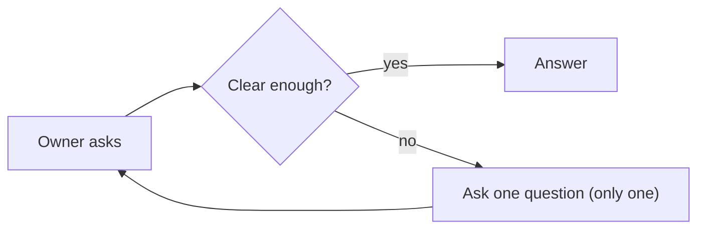
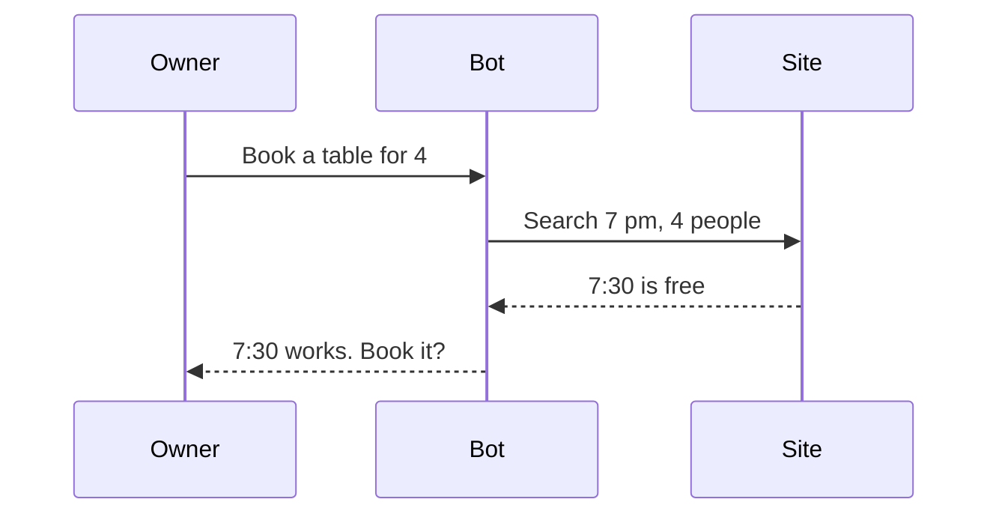
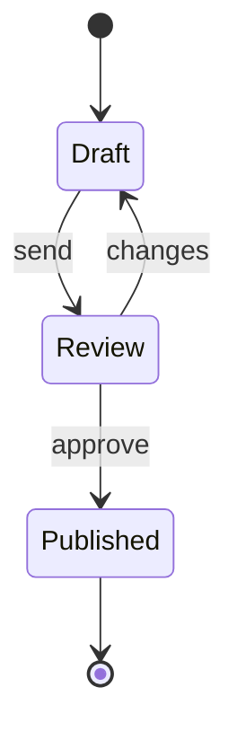
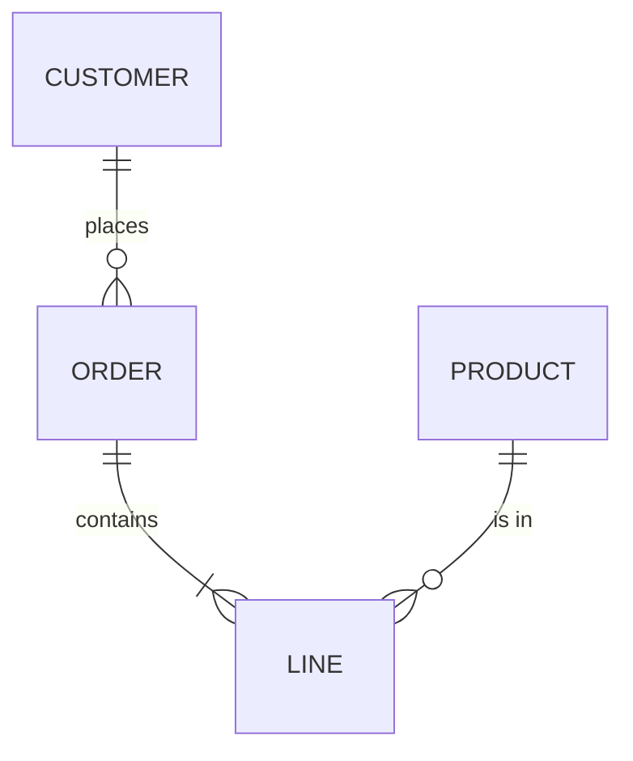
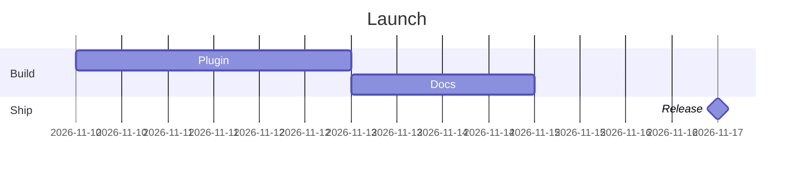
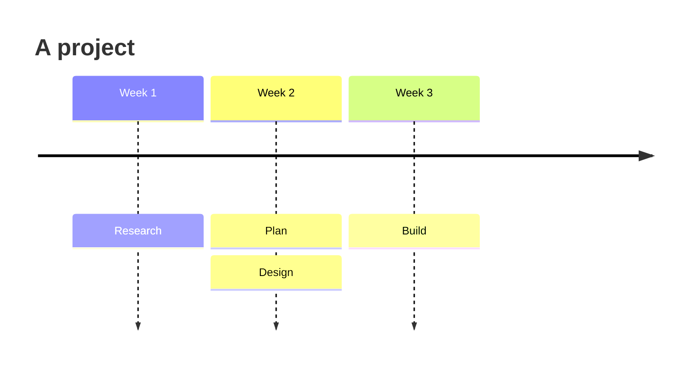
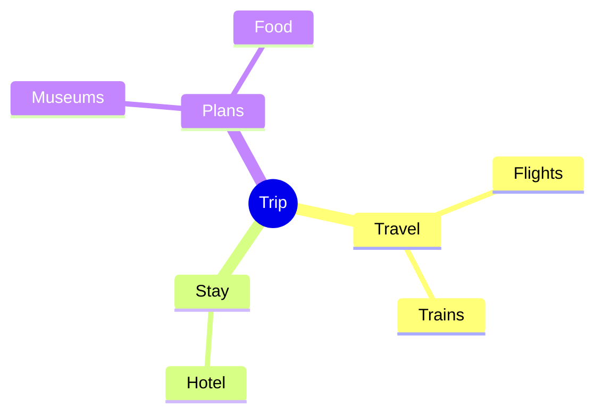
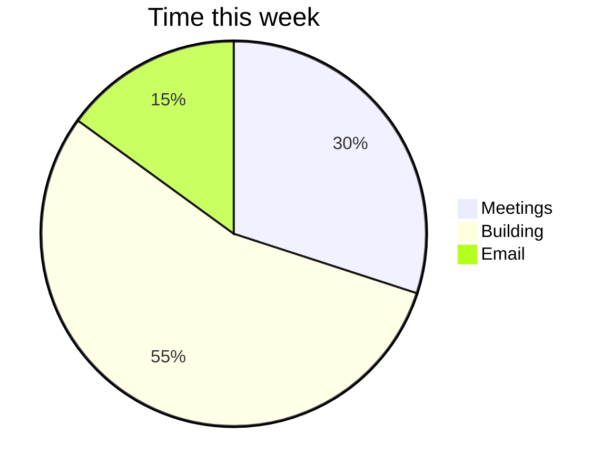
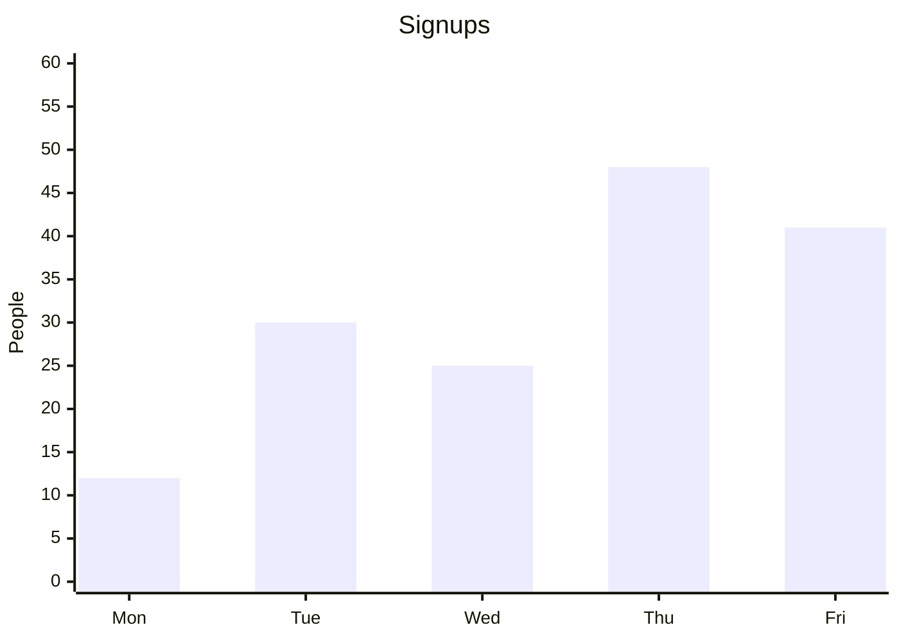

# Diagrams

Your replies and Markdown pages draw ```` ```mermaid ```` code blocks as diagrams, in the app's own colors and font. They're drawn by Pele, which reads Mermaid's syntax. The owner sees the diagram, and can switch to its code, copy it, download it, or open it full screen.

## When to draw one

| To show | Draw |
| --- | --- |
| A process with steps and choices | `flowchart` |
| What happens between people, services, or systems, in order | `sequenceDiagram` |
| States, and what moves between them | `stateDiagram-v2` |
| Things and how they relate | `erDiagram`, `classDiagram`, or `mindmap` |
| Dates and durations | `gantt` or `timeline` |
| Shares of a whole | `pie` |
| Numbers over time | `xychart` |

Don't draw one for a list, a few steps in a row, or a comparison: a list or a table says it better. Keep a diagram to one point, under about 25 nodes or 15 messages. For more, draw two.

Say in a sentence what it shows, next to it.

## Writing one that draws

- **Open with the fence and the type:** ```` ```mermaid ````, then the type on the first line, such as `flowchart LR`.
- **Quote a label with punctuation:** `A["Step 1 (draft)"]`. For a quote mark inside one, write `#quot;`.
- **No lowercase `end`** as a word in a flowchart's text or as an id. Write `End`, or quote it.
- **A space after a link** before an id that starts with `o` or `x`: `dev --- ops`, not `dev---ops`, which reads as a circle arrow.
- **One statement a line.** Arrows are `-->` in a flowchart, and `->>` and `-->>` in a sequence diagram. A link's label goes `A -->|yes| B`.
- **Direction:** `LR` reads left to right, `TD` top to bottom. On a phone, a wide diagram turns to run top to bottom by itself.
- **What fxbot leaves out:** links and `click`, images, icons such as `fa:fa-car`, math, and HTML in labels. Frontmatter and `%%{init}%%` can't change its colors, fonts, or look: the app sets them.

## Check it

Before you send a diagram, call `mermaid_check` with its source, without the fence. It draws it as the owner will see it, and answers what it drew, or the error and its line. Fix it, and check again.

## Examples

Each of these draws.



















## When one doesn't draw

The owner sees its code, and a line with the error. When they tell you, fix it, check it with `mermaid_check`, and send it again.
